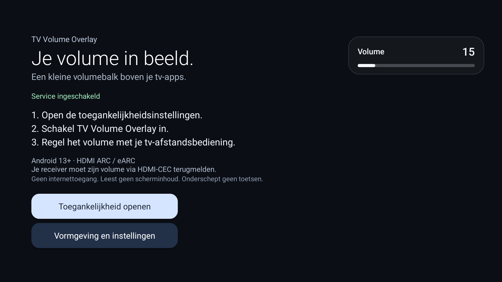
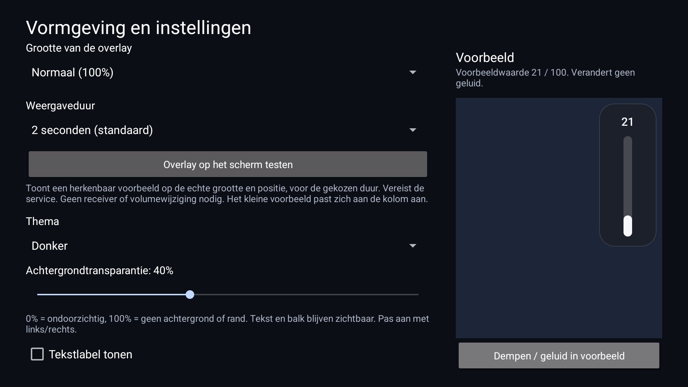

# TV Volume Overlay

A small, free volume display for Android TV apps when sound goes to an HDMI ARC/eARC receiver.

Some TVs send volume commands to the receiver but show no volume bar inside Netflix or other
built-in apps. TV Volume Overlay displays the level Android receives back from the audio system.
It works with your existing launcher.

> The latest stable release is **1.0.0**. The settings below are being developed for **1.1**;
> see [validation status](docs/VALIDATION.md) before trying a development build.

[**Download the latest APK**](https://github.com/MathiasVandePol/tv-volume-overlay/releases/latest)



_Screenshots show the 1.1 development build on a physical Xiaomi MiTV-MOEU0 running Android 14._

## Requirements

- Android TV / Google TV running **Android 13 or newer**.
- Media audio routed through **HDMI ARC or eARC**.
- A receiver/soundbar and TV firmware that expose the current volume through Android's audio APIs.

Tested on Xiaomi **MiTV-MOEU0**, Android 14, with a Denon **AVR-X3400H**.
Other models are welcome to try it; compatibility depends on the TV firmware and receiver.
This version does not display volume for optical, Bluetooth, TV speakers or a TV box's ordinary HDMI output.

## Install

1. Download the APK from [Releases](https://github.com/MathiasVandePol/tv-volume-overlay/releases/latest) and install it on the TV.
2. Open **TV Volume Overlay** from the TV's app list.
3. Select **Open Accessibility settings**, then enable **TV Volume Overlay**.
4. Use your TV remote's volume buttons, including while watching a video.

By default the small **Volume** panel appears near the upper-right corner and disappears about two seconds
after the last volume change by default. Muting displays **Muted**. English and Dutch interfaces are included.
The number uses Android's reported range, such as `21 / 100`; it is not a dB reading.

### Enable USB debugging and connect ADB

Debugging is needed only if you install using ADB; the overlay itself does not require it.
Install [Android SDK Platform-Tools](https://developer.android.com/tools/releases/platform-tools)
on your computer to get the `adb` command.

1. Open the TV’s **Settings → System → About**, or **Settings → Device Preferences → About**.
2. Select **Android TV OS build** / **Build** seven times with the remote until the TV says
   **You are now a developer**. Enter your TV PIN if prompted.
3. Go back to **System** / **Device Preferences**, open **Developer options**, and enable
   **USB debugging** (sometimes called **ADB debugging**). Menu names vary by manufacturer.
4. Connect using one of the methods below. When the TV asks **Allow USB debugging?**, accept the
   computer’s RSA authorization prompt. Select **Always allow from this computer** only for your own computer.
5. Run `adb devices`. The TV should appear with status **device**. If it says **unauthorized**,
   accept the prompt on the TV; if necessary, reconnect to show it again.

**Over the local network:** keep the computer and TV on the same local network. If the TV offers
**Network debugging** / **ADB over network**, enable it and use the address/port it shows. Some TV
firmware exposes network ADB when USB debugging is enabled; port `5555` is common but not universal.
Find the TV’s address under **Settings → Network → connected network → IP address**, or **About → Status**.
Replace `TV_IP` below with that address and use the TV’s port:

```sh
adb connect TV_IP:5555
adb devices
```

If the TV instead offers **Wireless debugging → Pair device with pairing code**, use:

```sh
adb pair TV_IP:PAIRING_PORT
adb connect TV_IP:ADB_PORT
adb devices
```

Enter the pairing code shown on the TV when asked. The pairing port comes from the pairing dialog;
the connection port comes from the main Wireless debugging screen and can be different. If a
connection is refused, confirm that the matching debugging option is enabled and use its displayed port.

**Over USB:** use this only if your TV supports an ADB/device USB connection, with a supported data
cable and port. Many TV USB ports are for accessories/storage and cannot connect to a computer for ADB.
After connecting, accept the TV’s authorization prompt and run `adb devices`.

See Google’s [developer-options guide](https://developer.android.com/studio/debug/dev-options) and
[ADB connection guide](https://developer.android.com/tools/adb) for the general setup.

### Install the APK with ADB

After the TV appears as **device** in `adb devices`, run:

```sh
adb install -r TV-Volume-Overlay-v1.0.0.apk
```

If an Android TV 14 installer waits for an on-screen confirmation, accept it on the TV, or push
the APK and install it through a separate shell call:

```sh
adb push TV-Volume-Overlay-v1.0.0.apk /data/local/tmp/tv-volume-overlay.apk
adb shell pm install -r /data/local/tmp/tv-volume-overlay.apk
adb shell rm /data/local/tmp/tv-volume-overlay.apk
```

If Android blocks enabling a sideloaded accessibility service, look in the app's information page
for **Allow restricted settings**. Availability and wording differ between TV firmware versions.
After sideloading, turn **USB debugging**, **Network debugging** and/or **Wireless debugging** off
again, depending on what you enabled. Use **Revoke USB debugging authorizations** and remove the
paired computer under Wireless debugging if you no longer need that access. The app keeps working
with debugging disabled.

## Appearance and settings (development version)

Open **Appearance and settings** in the app. Choices are saved automatically on the TV.
The small preview uses sample data and fits its column. **Test overlay on screen** displays the
actual overlay at your chosen size and position, with a **TEST · SAMPLE** badge and sample level
21 / 100 for the selected duration. The service must be enabled, but no receiver/ARC connection is
needed for this deliberate test. It never changes volume or mute state. Normal volume feedback
still requires the active ARC/eARC route. The badge remains visible even if you hide all other text.



- Six positions: top/bottom, left/center/right.
- Horizontal or slim vertical bar; dark, light or black theme. The vertical panel narrows further when text/numbers are hidden.
- Small (75%), normal (100%) or large (125%) size, scaling the text and bar together.
- Background transparency from 0% (opaque) to 100% (no background/border). Text and bar remain visible. Default: 8%.
- Display duration of 1, 2 (default, about 1.9), 3 or 5 seconds.
- Custom text label (up to 32 characters), or hide the label entirely. Blank custom text restores **Volume**.
- Number format: **21 / 100**, **21**, or **Hidden**. Hiding both text and numbers leaves just the bar.
- Muting replaces a visible label with **Muted**, replaces a visible number with a dash and colors the bar red.
- **Hide on TV input screens** is on by default to avoid a duplicate bar from your receiver.
- **Hide app icon from launcher** removes the launcher entry while the service keeps working.

Input suppression discovers apps handling Android TV channel/passthrough viewing intents, then
uses activity package/class metadata to recognize those screens. It does not identify the exact
HDMI socket or read screen content. Live TV in the same input-viewer app can also be suppressed.
The settings page shows how many input apps were detected; zero means automatic hiding is unavailable
on that firmware. You can disable suppression if it hides a screen where you want the overlay.
Input suppression has been checked on the Xiaomi/Denon setup above. Other TV firmware can affect discovery and foreground events.

### Reopen after hiding the icon

Go to **TV Settings → Accessibility → TV Volume Overlay → Settings**, open appearance settings and
turn off **Hide app icon from launcher**. The accessibility service's Settings entry remains available
whether the service is on or off, where supported by your TV's settings app. Some launchers cache icons.

If your firmware omits that Settings button, use ADB to open the setup screen explicitly:

```sh
adb shell am start -n be.mathiasvandepol.tvvolume/.MainActivity
```

You can also restore the launcher entry directly:

```sh
adb shell pm enable be.mathiasvandepol.tvvolume/.LauncherEntry
```

Only the launcher alias is disabled; the setup activity and service remain enabled.

## Why Accessibility?

Android permits an enabled accessibility service to host a window above other apps. This service
uses that window type to show the volume. The development version also observes activity package/class
metadata to suppress the overlay on TV input screens. That current package is held only in memory. It cannot read screen content and does not request
key-event filtering. Volume long-presses remain handled by Android and HDMI-CEC.

The app:

- Has **no Internet permission**, ads, analytics, accounts or runtime third-party libraries.
- Does not change volume, intercept remote keys or request audio focus.
- Reacts to Android volume/mute notifications; it does not poll the receiver or network.
- Checks the active media route before showing a panel; merely having an HDMI cable connected is not enough.
- Removes the panel after the selected duration (about 1.9 seconds by default), and when its service stops.

## Turn it off

Disable **TV Volume Overlay** in the TV's Accessibility settings, or uninstall the app.
HDMI-CEC and audio settings are not changed. The optional hidden launcher entry can be restored as described above.

## Build

Install JDK 17 and Android SDK 35, then run:

```sh
./gradlew testReleaseUnitTest lintRelease assembleDebug
```

The debug APK is in `app/build/outputs/apk/debug/`. A debug build uses a different signing key from
the published release; uninstall one before installing the other.

For a signed release, copy `keystore.properties.example` to `keystore.properties`, fill in your
own keystore details and run `./gradlew assembleRelease`. Keystores and local properties are ignored
by Git. Release maintainers can alternatively supply the four `ANDROID_*` environment variables
listed in the release workflow.

Pushing a `vMAJOR.MINOR.PATCH` tag runs the signed release workflow after its tests and lint pass.
It publishes the APK and `SHA256SUMS`. The repository uses a dedicated release key stored as GitHub
Actions secrets; never commit signing keys or passwords. See [CONTRIBUTING.md](CONTRIBUTING.md).

## Troubleshooting

**Number differs from the receiver / no half steps:** this app reads Android’s integer media-volume
index. The CEC audio-status volume is also an integer, not the receiver’s original decimal/dB display.
The receiver can use a different scale, and Android updates can arrive later. The app cannot reconstruct
missing half steps or guarantee an exact front-panel match. No guessed offset or fake decimals are applied.
Use the bar without numbers if you prefer. An exact receiver-specific network integration is not included.

**No panel:** verify that the service is enabled, audio is actually routed to ARC/eARC, and the
receiver reports its volume. Some firmware does not expose those reports to normal apps.

**Panel visible on Home but not over video:** protected playback or firmware window rules may
restrict overlays. Please report the TV, Android version, receiver and affected app. On the tested
MiTV/Denon setup the panel was confirmed visible during Netflix playback with the real remote.

**Two bars when using an AVR HDMI input:** enable **Hide on TV input screens** in a development build
and check the detected input-app count. The stable 1.0.0 release has no automatic suppression;
disable that version temporarily if you prefer the receiver’s own display on those inputs.

**Two bars inside Android apps:** disable another overlay or an integrated overlay in your launcher.

**Volume changes only a few steps when held:** this app deliberately requests no key filtering.
Check whether another enabled accessibility/remapping service requests key filtering. On the tested
TV, removing key filtering restored continuous volume changes.

## License

[MIT](LICENSE). Contributions and compatibility reports are welcome. See [NOTICE.md](NOTICE.md)
for the project's origins and Gradle attribution.
